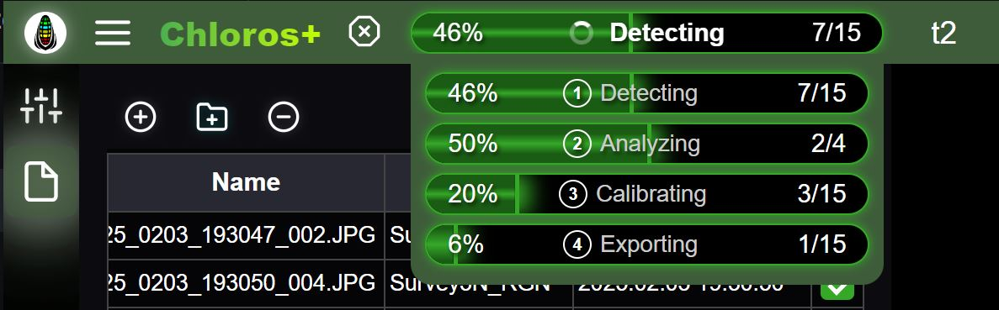

# Bevezetés

<figure><figcaption></figcaption></figure>
A

Chloros
a [MAPIR
](https://www.mapir.camera) által kifejlesztett szoftveralkalmazás, amely multispektrális képek feldolgozására, a MAPIR
hardverek élő vezérlésére és az érzékelőadatok rögzítésére szolgál. A Chloros
1.3.0 a teljes MAPIR
termékcsaládot támogatja:

* **a Survey3
kamerákat** — a RAW+JPG felvételek feldolgozásával kalibrált reflektancia- és vegetációs index-térképeket készít. Lásd a [Támogatott kamerák](supported-cameras.md) részt.
* **LATTICE kamerák** — a GigE multispektrális kameramodulok élőben történő csatlakoztatása, akár egyenként, akár szinkronizált többkamerás rendszerként: előnézet, felvétel és feldolgozás kalibrált sugárzási és reflexiós termékekké. Lásd a [LATTICE szakaszt](lattice/README.md).
* **DAQ fényérzékelők** — DAQ-U (USB), DAQ-M (Bluetooth), valamint DAQ-E és DAQ-E-S (Ethernet) spektrális érzékelők: élő, kalibrált spektrumok, `.daq` felvételek, valamint lefelé irányuló megvilágítás a reflexió feldolgozásához. Lásd a [DAQ szakaszt](daq/README.md).


**Újdonságok a Chloros
1.3.0-ban**: Az AI-asszisztensek az `chloros-mcp`-en keresztül vezérelhetik a Chloros
-t, és a CLI
, az SDK
, valamint az `chloros-mcp` is ugyanazokat a funkciókat kínálja. A LATTICE index termékek továbbfejlesztésre kerültek, a teljes szenzortömbök gyorsabbak és bármilyen hálózaton működnek, a háttérrendszer pedig a parancsok között is folyamatosan fut. Tekintse meg az alábbi Újdonságok listát, és [Töltse le](download.md) a telepítőket.



**Chloros
-t használ AI-asszisztenssel?** Ez a kézikönyv pontosan erre készült. Irányítsa asszisztensét a következőkre:

* `https://mapir.gitbook.io/chloros/llms.txt` — minden oldal géppel olvasható indexe.
* Bármely oldal nyers Markdown formátumban — egészítse ki az URL
-t az `.md` kiterjesztéssel (pl. `https://mapir.gitbook.io/chloros/reference/cli-reference.md`).
* A [CLI
-referencia](reference/cli-reference.md) és az [SDK
-referencia](reference/sdk-reference.md) — teljes, pontos értékeket tartalmazó referenciaoldalak, amelyeket LLM-ek számára írtak.

Példa parancsra: *„Olvasd el az https://mapir.gitbook.io/chloros/reference/cli-reference.md, fájlt, majd írj egy szkriptet, amely bejelentkezik és feldolgozza a ~/flights/flight_001 mappát, hogy reflectancia + NDVI
GeoTIFF fájlokat hozzon létre.”*

Vagy futtassa közvetlenül a Chloros
-t: az `chloros-mcp`, egy az SDK
-szel együtt telepített MCP-kiszolgáló, együttműködik a Claude Desktop, a Claude Code, a Cursor és más MCP-kliensekkel.

Teljes útmutató: [Chloros
használata AI-asszisztensekkel](ai-assistants.md).


***

## Újdonságok a Chloros
1.3.0-ban

* **Az AI-asszisztensek vezérelhetik a Chloros
-t.** Az `chloros-mcp`, egy Python
SDK
-szel telepített MCP-kiszolgáló lehetővé teszi a Claude Desktop, a Claude Code, a Cursor és más MCP-kliensek számára a képek feldolgozását, valamint a LATTICE kamerák, érzékelősorok és DAQ fényérzékelők működtetését. Lásd: [A Chloros
használata AI-asszisztensekkel](ai-assistants.md).
* **A CLI
, az SDK
és az `chloros-mcp` ugyanazokat a funkciókat kínálják.** Biztonsági okokból csak a bejelentkezés, a DAQ-E-beállítás és a közvetlen DAQ-kiszolgálók maradnak a CLI
-nél. Néhány 1.2.0-s szkript módosításra szorul: lásd a **Változások az 1.3.0-ban** című részt a [CLI
-referencia](reference/cli-reference.md) és az [SDK
-referencia](reference/sdk-reference.md) tetején.
* **Továbbfejlesztett LATTICE-indextermékek.** Az NDVI
és a LATTICE-felvételekből exportált egyéb indextermékek minden feldolgozási módban továbbfejlesztésre kerültek.
* **Windows
-telepítő opciók.**A**Rendszerbeállítások**alatt a telepítő a**Windows
hosszú útvonalak engedélyezése**és a**A Chloros
háttérprogram kizárása a Microsoft Defender vizsgálatából** opciókat kínálja, amelyek alapértelmezés szerint mindkettő be van jelölve. Az első lehetőség lehetővé teszi, hogy a projektmappák neve 260 karakternél hosszabb legyen; a második megakadályozza, hogy a valós idejű vizsgálat lelassítsa a kamera rögzítését (magas sebesség mellett a rögzítési sebesség körülbelül 30%-át). A telepítő mostantól az CLI
mappát is csak egyszer adja hozzá az `PATH` mappához, és eltávolítja a korábbi telepítők által hagyott duplikált bejegyzéseket. Lásd [Letöltés](download.md).
* **A túl mély projektmappákat már az elején elutasítja a rendszer.** Ha a Windows
hosszú elérési útvonalak használata ki van kapcsolva (ez a Windows
alapértelmezett beállítása), a 260 karakteres elérési útvonal-korlátot meghaladó mélységű projektmappákat a rendszer már a futtatás megkezdése előtt elutasítja, és megjeleníti a leghosszabb, a korláton belül maradó projektmappát, valamint a hosszú elérési útvonalak bekapcsolásának módját. Korábban egy ilyen futtatás során nem készültek termékfájlok. A hosszú elérési utak engedélyezése esetén a nagyon mély mappákban található termékek most már megőrzik metaadataikat (GPS- és XMP-címkéket).
* **Maszkok korlátozása.** Ha egy LATTICE sugárzási vagy visszaverődési termék sávszétválasztása negatív sávértéket eredményez, az értéket nullára korlátozzák, és a termékmappák mellett található `clamp_masks/` mappában egy pixelenkénti maszk rögzíti, mely pixeleket és sávokat érintett a korlátozás. A termék az `Chloros:UnmixClampMask` címkében nevezi meg a maszkját. Az élő nézetek mostantól pontosan úgy vágják le az értékeket, ahogyan az exportálás is teszi. Lásd [Kimeneti képformátumok](output-image-formats.md).
* **A termékek leírják magukat.** Az indextermékek a forrás nyersfájlok helyett saját feldolgozási címkéket hordoznak (`Chloros:ProcessingLevel=index`, az indexkifejezés, valamint az, hogy sugárzásból vagy visszaverődésből számították-e őket). A Survey3
-termékek minden feldolgozási módban Chloros
-feldolgozási címkéket hordoznak. A LATTICE nyers és debayered fájlok megőrzik az érzékelő natív tájolását, és ezt az XMP-ben is rögzítik; az Image Viewer kizárólag a megjelenítéshez fordítja el őket.
* **A Linux
-csomagok kicsomagolatlanul kerülnek forgalomba.** A háttérprogram és a CLI
az `/usr/lib/chloros/` alatt mappákként kerülnek telepítésre, így már nem csomagolják ki magukat minden indításkor. x86_64 rendszeren a háttérprogram indítása már nem tart körülbelül 100 másodpercig, és az `.deb` mérete körülbelül a korábbi felére csökkent. A csomagban található ExifTool most már tiszta Ubuntu-telepítésen is fut. Az `.deb` most már a rendszerhez tartozó Python
SDK
-t is telepíti (az `python3` (telepítse az `sudo apt install ./chloros_1.3.0_<arch>.deb` paranccsal), növeli a kernel socket-fogadó puffereit, amelyekre a kamera adatfolyamainak szüksége van, és hozzáad egy háttérszolgáltatást, amely a felhasználó nevében fut. A Jetson-csomag, az `chloros_1.3.0_arm64_jp6.deb`, a JetPack 6-hoz készült, és a Jetson GPU-ján fut a JetPack CUDA-kompatibilis PyTorch-verziójával. Linux
rendszeren minden exportált kép most már egyszer kerül a lemezre (a memóriába írás és címkézés után a helyére másolás): a Jetsonon, ahol a lemez határozza meg a sebességet, egy 288 képet tartalmazó LATTICE-futás 14 percet vesz igénybe 24 helyett. Lásd [Linux
telepítés](linux/linux-installation.md).
* **A LATTICE OCN
kamerák napfényben pontosabban olvassák le az adatokat.** A sugárzási, visszaverődési és indexértékek a sávszétválasztás után gyors korrekciót kapnak, így egy szürke célpont napfényben közel semleges NDVI
-értéket mutat. Az RGN
kameráknál nincs változás.
* **Alkalmazáson belüli hibajelentések.** A Debug Log fül tetején található hibaikon segítségével leírás, legfeljebb 10 kép, a naplófájlok és a rendszeradatok elküldhetők a MAPIR
-nek. Lásd: [GUI: Navigáció](navigation.md).
* **LATTICE-mátrixok.**A mátrixok alapértelmezés szerint megőrzik a teljes érzékelőadatot, és a tömörített 12 bites adatátvitel (`--packed`, alapértelmezés: `auto`) körülbelül egyharmadával növeli a teljes érzékelő képkockasebességét; egy tömb bármely hálózaton működik az általa lehetővé tett képkockasebességgel (egy lassú kapcsolat csökkenti a képkockasebességet, ahelyett, hogy elutasítaná a tömböt vagy kicsinyítené a képkockáit); egy olyan tömb, amelynek kameráit újraindították, önmagától helyreáll, és a PTP újra bekapcsolódik; az automatikus expozíció gyenge fényviszonyok mellett már nem csökkenti ezt a sebességet (kitölti az időtartamot, majd növeli az erősítést); A folyamatos rögzítés lépést tart a gyors rendszerekkel; egy**Highlights** vezérlő az RGB
-kamerákhoz; valamint az SDK
`ArraySession` kiterjesztései: `grab()`, `frame_stream()` és `continuous()` kiterjesztéseket kap. Lásd a [LATTICE szakaszt](lattice/README.md).
* **Stabilabb automatikus expozíció.** Az expozíció állandó fényviszonyok mellett változatlan marad, és a változást követően néhány másodpercen belül stabilizálódik; a kis fényes területek már nem sötétítik el a képet; kézi expozíció esetén az erősítés automatikus beállításon marad; az erős napfényben nem reagáló kamera pedig a fényérzékelő által mért fényszintet tartja, vagy – ha nincs csatlakoztatva fényérzékelő – a kamera saját képkockái alapján. Lásd a [Kamera beállítások](lattice/camera-settings.md) részt.
* **Fényérzékelők.** **DAQ-E-S támogatás:** a rögzített diffúzor nem igényel fedélkorrekciót, és minden leolvasás tartalmazza a készülék dőlés-, forgás- és emelkedési szögét. A felvétel jelzi, hogy a fedelet kifejezetten választották-e ki, vagy a rendszer feltételezte annak jelenlétét; a feldolgozás figyelmeztet, ha a fedelet a rendszer feltételezte: a DAQ-U, DAQ-M és DAQ-E készülékek fedél nélkül kerülnek forgalomba, ezért nevezze meg a felszerelt fedelet. Az élő `.daq` felvételek áramkimaradás után is megmaradnak (tartson meg egy `.daq-journal` fájlt az `.daq`-szel együtt), és egy olyan DAQ-E, amely leáll az adatátvitelről, újra csatlakozik úgy, hogy a felvételében megjelölve van a szünet. Egy olyan projekt, amely kizárólag fényérzékelő-felvételeket tartalmaz, azokat felsorolja és feldolgozza az alkalmazásból és a CLI
-ből, és az `chloros_scripts`-szel készített felvétel a készítő DAQ-ként szerepel, egy Ön által beállítható korlát mellett. Minden rögzítés elmenti a felhasználásra került DAQ-értéket. Lásd a [DAQ szakaszt](daq/README.md).
* **Feldolgozás.**A LATTICE-képkockák feldolgozása a célpont-felismerés során kezdődik. A célpont- és DAQ-referenciákat sávonként határozzák meg. Egy áthelyezett projekt újra összekapcsolja a fájljait. Egy 8 bites rögzítés exportált adatai 8 bitesek, egy új**TIFF
(8 bites)** formátumban. A kalibrációs célpont nélkül futtatott Survey3
-futás a tartaléktermékként kerül mentésre (`Vignette_Corrected_Images` vagy `Sensor_Response_Images`), nem pedig reflektancia-képként. A reflektancia-kép sávonkénti DLS-címkéi mindig a saját képkockájához tartoznak. A „Texture Aware” beállítás nem engedélyezett a LATTICE-felvételek esetében, amelyek mindig a standard debayert kapják.
* **CLI
és SDK
.** A relatív kimeneti útvonalak mostantól abban a mappában jelennek meg, ahonnan a parancsot vagy a szkriptet futtatja (a korábban telepített háttérprogramok ezeket a saját telepítési mappájukban próbálták feloldani, ami hibaüzenetet eredményezett). A háttérprogram a parancsok és szkriptek között folyamatosan fut, és 30 perc használat nélkül magától leáll; ezt az `chloros-cli backend status` és az `backend stop` kezeli. A rögzítési parancsok felsorolják az összes olyan fájlt, amelyet nem tudtak írni, majd 1-es kóddal lépnek ki, és az ismételt rögzítések leállnak, ha a meghajtó megtelik. A sikeres `process` futtatás `Image products written: N (plus M clamp masks)` kódot jelent. Windows
rendszeren az SDK
`ChlorosLocal` / `process_folder` parancsai megtalálják a telepített háttérprogramot (és a már futó programot használják), az `read_image_audit_tags` pedig egy egyszerű `pip install` fájlból működik.

***

## Újdonságok a Chloros
1.2.0-ban

* **Élő kameravezérlés — új „Kamerák” fül.** Csatlakoztathat LATTICE kamerákat egyenként vagy szinkronizált többkamerás rendszerként (PTP időszinkronizálás, hardveres kiváltású felvétel), élő előnézeti átfedésekkel, sávonkénti hisztogramokkal, intelligens automatikus expozícióval, élő indexszámítóval és az alkalmazáson belüli kamera-firmware-frissítésekkel.
* **Fényérzékelők — új „Fényérzékelők” fül.** Csatlakoztathat DAQ-U (USB), DAQ-M (Bluetooth) és DAQ-E (Ethernet) érzékelőket; tekintse meg az élő, kalibrált spektrumokat (W/m²/nm), rögzítse az `.daq` fájlokat a projektjébe, válasszon fényerő-korrekciós profilokat, és frissítse a DAQ-E firmware-jét a hálózaton keresztül.
* **Rögzítési módok és rögzítők.** Egyszeri / Folyamatos / Intervallumú rögzítés, valamint kizárólag nyers adatokat rögzítő „Leggyorsabb rögzítés” mód; projektenkénti kiválasztás, hogy a „Minden rögzítése” funkció mely kamerákból és exporttípusokból állítson elő adatokat; tömbös rögzítők monitoring minőségű indexvideókhoz és elemzési minőségű nyers adatsorozatokhoz, offline videó-összeállításokkal.
* **LATTICE feldolgozási folyamat.** Importálja a LATTICE rögzítési mappákat, és bontsa ki az egyes nyers képkockákat debayered, előnézeti, float32 sugárzási (W/m²/sr/nm) és reflexiós termékekre, termékenkénti kapcsolókkal. A reflexió származhat egy képkockán belüli kalibrációs célpontból vagy DAQ lefelé irányuló sugárzásból; az exportokra tömbös igazítás kerül alkalmazásra; a hiányzó gyári kalibrációt a kamera sorozatszáma alapján automatikusan letölti a rendszer.
* **A projektek megjegyzik a hardvert.** A csatlakoztatott kamerák és fényérzékelők a projekttel együtt kerülnek mentésre (`cameras.json` / `sensors.json`), és a projekt újbóli megnyitásakor a mentett beállításokkal csatlakoznak újra. Lásd [GUI: Projektek](projects.md).
* **Képmegjelenítő frissítések.** A kurzor pixel/index kiolvasása a fájlonkénti helyes reflexiós skálázással, réteghisztogramok, GSD-binning csúszka, „Per Trigger” / „Per Camera” rács módok, LATTICE terméknézetek, valamint Index/LUT sandbox exportálás lemezre.
* **A CLI
és az SDK
jelentősen kibővült.** Új `lattice`, `daq pool-*`, `project` és `time-sync` parancscsaládok; új `process` opciók (`--input-level`, termékenkénti kapcsolók, `--reflectance-source`, tömb-igazítási jelzők); SDK
intelligens csatlakozási kezelők (`connect_camera` / `connect_array` / `connect_daq_sensor`), amelyek automatikusan elindítják a háttérprogramot; `open_project()` automatizálás; az SDK
-kerék a telepítőkkel együtt van csomagolva, és `chloros-sdk` néven kerül közzétételre a PyPI-n.
* **Egyértelmű hiba-szemantika.** Egy olyan `chloros-cli process` futtatás, amely termékeket kért, de egyet sem írt ki, most egyértelműen hibaüzenetet ad és nem nulla kóddal lép ki; a sikeres futtatások jelentik, hogy hány képterméket írtak ki.
* **Új kimeneti elrendezés.** A termékek az `<project>/<camera>/<format>/<Product>_Images/` mappákba kerülnek, és megtartják a forrásfájl nevét — a mappanév, nem pedig a fájlnév kiterjesztése azonosítja a terméket. Lásd [Kimeneti képformátumok](output-image-formats.md).
* **Több bemeneti lehetőség, terv és nyelv.** `.dng` bemeneti támogatás; mind a 38 felületi nyelv teljes körűen elérhető; tervenkénti hardverkorlátozások, ingyenes (bejelentkezés nélküli) használat esetén legfeljebb 4 kamera és 2 fényérzékelő használatával.
* **Megbízhatóság.** A „Feldolgozás leállítása” funkció tisztán leállítja a folyamatot, pontos futási összefoglalóval; a többkamerás projektek minden kamerát exportálnak, és a telepítő frissítései már nem jelentik ki a felhasználót.***

A Chloros
3 felhasználói felületen érhető el:

## Chloros
: Asztali GUI-alkalmazás

Önálló, külön ablak az összes funkcióval, beleértve az Élő kamerák és Fényérzékelők lapokat is. _Csak Windows._

## [Chloros
CLI
: Parancssori felület](CLI.md)

Parancssori kötegelt feldolgozás, valamint élő `lattice`, `daq pool-*`, `project` és `time-sync` parancsok. Tökéletes automatizáláshoz, szkripteléshez és headless üzemmódhoz. Elérhető **Windows
, Linux
amd64 és Linux
arm64 (NVIDIA Jetson)** rendszereken. _A CLI
használatához fizetős Chloros
+ csomagra van szükség._

## [Chloros
API
: Python
SDK
](api-python-sdk.md)

Programozási Python
-felület automatizáláshoz és egyedi munkafolyamatokhoz: teljes feldolgozási folyamat, élő kamera-/tömb-munkamenetek, DAQ-érzékelő-munkamenetek és mentett projektek automatizálása. A desktop/CLI csomaggal együtt telepíthető, valamint `pip install chloros-sdk` néven is elérhető. _Az API eléréséhez fizetős Chloros
+ előfizetés szükséges._

***

## Támogatott platformok

| Platform | GUI | CLI
| Python
SDK
|
| --- | --- | --- | --- |
| **Windows
10/11 (x64)** | Igen | Igen | Igen |
| **Linux
amd64 (x86_64)** | Nem | Igen | Igen |
| **Linux
arm64 (NVIDIA Jetson)** | Nem | Igen | Igen |

A Linux
telepítési útmutatásait lásd a [Linux
és Edge Computing](linux/linux-overview.md) szakaszban.

***

## Három lépésben kezdj hozzá

1. **Telepítés** — töltse le és futtassa a platformjához megfelelő telepítőt. Lásd: [Letöltés](download.md).
2. **Bejelentkezés (opcionális a grafikus felhasználói felület esetén)** — a grafikus felhasználói felület fiók nélkül is ingyenesen feldolgozza a képeket. A [Chloros
+ bejelentkezés](chloros+-login.md) lehetővé teszi a párhuzamos feldolgozást, a GPU-gyorsítást, a magasabb eszközkorlátokat, valamint a CLI
/SDK
-hozzáférést.
3. **Készítse el az első projektjét** — nyissa meg a Chloros
-t, hozzon létre egy [Új projektet](projects.md), [adja hozzá a képeit](processing-images-gui/adding-files-to-a-project.md), majd [indítsa el a feldolgozást](processing-images-gui/starting-the-processing.md). Ha inkább élő hardvert szeretne vezérelni, nyissa meg a Kamerák vagy Fényérzékelők fület — lásd [GUI: Navigáció](navigation.md).

***

## Chloros
+

Bár a Chloros
a legtöbb feladatra ingyenesen használható, előfordulhat, hogy többet szeretne. Ilyenkor a Chloros
+ fizetős licencével jól járhat. A Chloros
+ licenccel új funkciókat nyithat meg, például:

* **Többszálas feldolgozás**: jelentősen felgyorsíthatja a képfeldolgozást nagyobb projektek esetén azáltal, hogy a képeket párhuzamosan dolgozza fel a feldolgozási folyamatban.
* **GPU (CUDA) gyorsítás**: használja ki a mai nagyobb GPU-memória-kapacitásokat a képfeldolgozási folyamat további felgyorsításához. A legjobb eredmények elérése érdekében 4 GB vagy annál nagyobb VRAM-ot javaslunk.
* **Chloros
+**[**CLI**](CLI.md) **Hozzáférés**: futtassa a Chloros
+ programot a parancssorból a saját szoftverébe történő automatizálás és integrálás érdekében. Bármely fizetős csomagban elérhető; szerveroldalon érvényesül.
* **Chloros
+**[**API**](api-python-sdk.md) **Hozzáférés:** futtassa a Chloros
+ programot Python
ból a programozási vezérlés érdekében, ami zökkenőmentes integrációt tesz lehetővé kutatási folyamatokba, adatelemzési munkafolyamatokba és egyedi alkalmazásokba. Bármely fizetős csomagban elérhető; szerveroldalon érvényesül.
* **Magasabb hardverkorlátok**: egyszerre több kamera és fényérzékelő csatlakoztatható. Bejelentkezés nélkül a grafikus felhasználói felület (GUI) legfeljebb 4 kamerát és 2 DAQ fényérzékelőt tud csatlakoztatni; a fizetős csomagok mindkét korlátot megemelik:

| Csomag | Kamerák | DAQ fényérzékelők |
| --- | --- | --- |
| Iron (ingyenes, bejelentkezés nélkül) | 4 | 2 |
| Copper / Bronze | 6 | 3 |
| Silver | 10 | 6 |
| Gold | 20 | 12 |

* **Több eszköz használata**: minden Chloros
+ licenc 2 vagy több eszköz regisztrációját teszi lehetővé. A regisztrált eszközöket a MAPIR
Cloud-fiókjával kezelheti. A Chloros
+ licenc frissítésével további eszközök támogatását is biztosíthatja.
* **Fejlett, textúraérzékeny debayer-módszer:** kiváló minőségű, élekkel számoló debayer, amely egy AI/ML zajszűrő modellel kombinálva szinte teljesen eltávolítja a debayeringből származó zajt.
* **Egyedi multispektrális indexképletek:** adjon meg egyedi multispektrális indexeket a Chloros
raszterkalkulátorokban, mind a feldolgozáshoz, mind a képnézegető sandboxhoz.
* **Linux
és peremszámítás:** futtassa a Chloros
-t Linux
x86_64 és ARM64 platformokon, beleértve az NVIDIA Jetsont is, terepi és peremfeldolgozáshoz. Lásd a [Linux
áttekintést](linux/linux-overview.md).

<a href="https://cloud.mapir.camera/pricing" class="button primary" data-icon="envira">Chloros+ árak és regisztráció</a>

<figure><figcaption></figcaption></figure>

<figure><figcaption></figcaption></figure>

<figure><figcaption></figcaption></figure>

<figure><figcaption></figcaption></figure>

<figure><figcaption></figcaption></figure>

<figure><figcaption></figcaption></figure>
<!-- SCREENSHOT-UPDATE: cli.JPG shows the 1.1.0 CLI banner. Re-shoot a terminal running `chloros-cli --version` + `chloros-cli status` on the 1.3.0 build so the banner prints "Chloros CLI 1.3.0". -->
